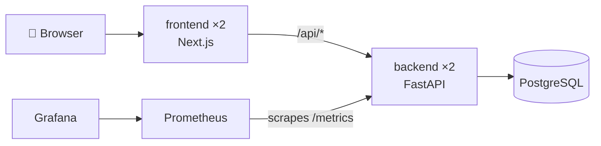
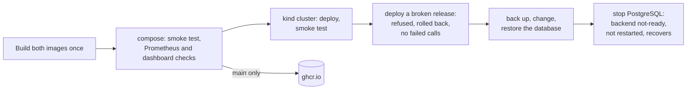

# deploy-baseline

[](https://github.com/builtbyshailendra/deploy-baseline/actions/workflows/ci.yml)


**Takes [serviceops-workbench](https://github.com/builtbyshailendra/serviceops-workbench) from "runs on my laptop" to container images, a one-command local stack, and a Kubernetes deployment that checks its own health and rolls back a bad release.**

> Personal learning project. Every person, team and request in the app is made up.

The app lives in [`app/`](app) as a git submodule pinned to one commit, so this repo always says exactly which version of the app it deploys.

## What runs where



Every push runs the whole thing in GitHub Actions:



| Path | What it is |
|---|---|
| [`docker/`](docker) | A Dockerfile for the backend and one for the frontend |
| [`compose.yaml`](compose.yaml) | The app, PostgreSQL, Prometheus and Grafana on one machine |
| [`k8s/base`](k8s/base) | Kubernetes manifests: two backend pods, two frontend pods, PostgreSQL |
| [`k8s/kind`](k8s/kind), [`kind/`](kind) | What a local kind cluster adds: the frontend on `127.0.0.1:8080` |
| [`scripts/deploy.sh`](scripts/deploy.sh) | Deploys one release and rolls it back if it doesn't become ready |
| [`scripts/`](scripts) | Smoke test, call watcher, monitoring check, database backup and restore |
| [`monitoring/`](monitoring) | Prometheus config and the Grafana dashboard |
| [`.github/workflows/ci.yml`](.github/workflows/ci.yml) | Everything above, on every push |

## Run it with compose

You need Docker. Clone with the app included:

```bash
git clone --recurse-submodules https://github.com/builtbyshailendra/deploy-baseline.git
cd deploy-baseline
docker compose up --build
```

| Open | For |
|---|---|
| http://127.0.0.1:3000 | The app. Use "Acting as" to switch between Asha, Ravi, Meera and Tom |
| http://127.0.0.1:3001 | The Grafana dashboard |
| http://127.0.0.1:9090 | Prometheus |

`docker compose down` stops everything and keeps the data. `docker compose down -v` deletes the data too.

## Run it in Kubernetes

You need Docker, [kind](https://kind.sigs.k8s.io/), kubectl and Python 3 for the smoke test.

```bash
kind create cluster --config kind/cluster.yaml
docker build -f docker/backend.Dockerfile -t ghcr.io/builtbyshailendra/serviceops-backend:dev app/backend
docker build -f docker/frontend.Dockerfile -t ghcr.io/builtbyshailendra/serviceops-frontend:dev app/frontend
kind load docker-image --name serviceops ghcr.io/builtbyshailendra/serviceops-backend:dev ghcr.io/builtbyshailendra/serviceops-frontend:dev
scripts/deploy.sh dev
python3 scripts/smoke.py http://127.0.0.1:8080
```

Then open http://127.0.0.1:8080. `kind delete cluster --name serviceops` removes the whole cluster.

To skip the builds, use the images CI publishes. They're public on GitHub Container Registry and tagged with the commit that built them, so after `kind create cluster`, this pulls and deploys the images for a commit on `main`:

```bash
scripts/deploy.sh <short commit id>
```

## Runbook

Commands for the Kubernetes setup. CI goes through each situation here on every push: a deploy, a release that fails and is rolled back, a database outage, and a backup and restore. The manual `rollout undo` and `rollout restart` commands aren't run by CI.

**Deploy a release.** A release is an image tag. The script waits until every pod of the new release is ready:

```bash
scripts/deploy.sh <tag>
```

**A release doesn't become ready.** Nothing to do: `deploy.sh` rolls back the backend and the frontend and exits with an error. The old pods keep serving the whole time, because an old pod is only removed once its replacement is ready. To see why the release failed:

```bash
kubectl -n serviceops get pods
kubectl -n serviceops logs deployment/backend --previous
kubectl -n serviceops rollout history deployment/backend
```

**Roll back by hand.** Deploying the last good tag again is the clearest way, because the tag says what's running. Kubernetes can also step back one revision:

```bash
scripts/deploy.sh <last good tag>
kubectl -n serviceops rollout undo deployment/backend
```

**Restart the pods.** One at a time, with the old pods serving until each new one is ready. Useful when a pod misbehaves but still passes its checks:

```bash
kubectl -n serviceops rollout restart deployment/backend
```

**The database is down.** The backend pods go not-ready and stop getting traffic, but they aren't restarted, because restarting them wouldn't help. Once PostgreSQL is back, they become ready again by themselves.

```bash
kubectl -n serviceops get pods -l app=postgres
kubectl -n serviceops logs statefulset/postgres
```

**Back up and restore the database.** A restore replaces everything, so anything written after the backup is lost. The script asks before it does that:

```bash
scripts/backup.sh > backup.sql
scripts/restore.sh < backup.sql
```

**Stop.** `kind delete cluster --name serviceops` deletes the cluster and its data.

## What it doesn't do

- **No cloud, and no Terraform yet.** Everything runs on one machine or in a kind cluster inside CI. Terraform for a real cluster and a managed database is the next step.
- **One PostgreSQL pod.** No replica and no scheduled backups. A real setup would use a managed database.
- **No ingress or TLS.** kind exposes the frontend on a port on `127.0.0.1`.
- **No Prometheus in the cluster.** Monitoring runs in compose only.
- **Images aren't signed or scanned.** They're pinned by version tag, not by digest.

## Build log

Built on 13 November 2026, one step at a time.

Docker Desktop doesn't run on my laptop, because WSL isn't installed there. So every container, compose and Kubernetes step was first run for real in GitHub Actions. Locally I ran what doesn't need containers: the app exactly as the containers start it, the Playwright tests against the standalone frontend build, the smoke test, and every workflow, script and manifest through `actionlint`, `shellcheck`, `docker compose config` and `kubectl kustomize`.

### Step 1: Dockerfiles for the backend and the frontend

**Built:** one Dockerfile per part of the app, kept in [`docker/`](docker) next to its own ignore file. The backend image is Python 3.12 slim with only the runtime packages and the `app` package. The frontend image is built in two stages: the first installs everything and builds Next.js as a standalone server, the second copies only that server and its static files. Both run as a fixed, unprivileged user id.

**Decision:** the Dockerfiles live here, not in the app repo. The app stays about the app; this repo is about running it. BuildKit reads `<name>.Dockerfile.dockerignore` next to each Dockerfile, so the ignore files can live here too.

**Learned:** Next.js writes the backend address into the build output, so `API_URL` is a build argument, not something to set when the container starts. Its default, `http://backend:8000`, is the service name used in both compose and Kubernetes.

### Step 2: one command for the whole app

**Built:** [`compose.yaml`](compose.yaml) runs PostgreSQL, the backend and the frontend. `docker compose up --build` builds both images and starts everything in order: the backend waits until PostgreSQL accepts connections, and the frontend waits until the backend is ready. Only the frontend and backend ports are published, and only on `127.0.0.1`. [`scripts/smoke.py`](scripts/smoke.py) walks one request from raised to done through the frontend, so a single run checks the page, the `/api` proxy, the backend and the database together.

**Decision:** the backend's health check in compose calls `/api/ready`, not `/api/health`, so "healthy" means it can reach the database, not just that the process is up.

### Step 3: CI builds, checks and pushes the images

**Built:** a GitHub Actions workflow. It checks out the app submodule, lints both Dockerfiles with `docker build --check`, builds each image once, starts the stack in compose from those images and runs the smoke test. On `main` it pushes them to GitHub Container Registry, tagged with this repo's commit. Each image also carries labels with this repo's commit and the app's commit, so `docker inspect` tells you exactly what's inside.

**Decision:** build once, test what ships. Compose takes the image names from `BACKEND_IMAGE` and `FRONTEND_IMAGE`, so CI tests the images it pushes instead of building fresh ones.

### Step 4: Kubernetes manifests with health checks

**Built:** manifests in [`k8s/base`](k8s/base) for PostgreSQL (one pod with its own volume), two backend pods and two frontend pods, plus a [`k8s/kind`](k8s/kind) overlay that puts the frontend on `http://127.0.0.1:8080` in a local [kind](https://kind.sigs.k8s.io/) cluster. [`scripts/deploy.sh`](scripts/deploy.sh) deploys one release (an image tag) and waits for it. CI now creates a kind cluster, deploys the images it just built and runs the smoke test through the cluster.

Every pod has three checks:

| Check | Backend | Frontend | What Kubernetes does when it fails |
|---|---|---|---|
| Startup | `/api/health`, up to 60 s | `/`, up to 60 s | Restarts the pod; the other two checks wait for it |
| Liveness | `/api/health` | `/` | Restarts the pod |
| Readiness | `/api/ready`, which needs the database | `/` | Stops sending it traffic, without a restart |

**Decisions:**
- **No database check in liveness.** If PostgreSQL goes down, restarting every backend pod wouldn't fix anything. The pods go not-ready instead and come back by themselves.
- **No unavailable pods during a rollout.** With `maxUnavailable: 0`, an old pod is only removed once its replacement is ready, so a release that never becomes ready leaves the old one serving.
- **Wait for the database in an init container.** On a fresh cluster the backend starts before PostgreSQL. Without the wait it crashes, and Kubernetes restarts it with a longer pause each time.
- **A five-second `preStop` pause.** Kubernetes stops routing to a pod and tells it to stop at about the same time. The pause lets in-flight requests finish.
- **Locked-down containers.** They run as non-root on a read-only filesystem with every Linux capability dropped. Next.js gets a small writable folder for its cache.
- **A generated database password.** The first time the deploy script runs, it makes a random password and stores it only as a Kubernetes Secret. It's never written to a file, this repo or the CI configuration.

**Learned:** the PostgreSQL image starts a temporary server while it creates a new database, listening only on its socket. `pg_isready` over the socket calls that "ready" a moment before it restarts, so the checks use `-h 127.0.0.1`. The compose file now does the same.

### Step 5: a failing deploy rolls back

**Built:** if a release isn't ready in time, [`scripts/deploy.sh`](scripts/deploy.sh) runs `kubectl rollout undo` on every Deployment that release changed and exits with an error. CI proves it on every push:

1. It builds a release called `bad`, whose backend crashes on startup ([`test/bad-release.Dockerfile`](test/bad-release.Dockerfile)). Its frontend is unchanged.
2. [`scripts/watch.py`](scripts/watch.py) starts calling the app through the cluster five times a second.
3. It deploys `bad`. The new backend pod never becomes ready, so the old pods keep serving. After 60 seconds the script rolls back both the backend and the frontend.
4. The job fails unless the deploy was refused, both Deployments are back on the previous images, the watcher saw no failed calls and the smoke test passes again.

**Decision:** roll back the whole release, not just the part that failed. Here the frontend went out fine, but leaving it on a release whose backend was refused would mix versions.

**Learned:** Kubernetes doesn't roll back by itself. A stuck rollout just stays stuck, with the old pods serving, until someone or something runs `kubectl rollout undo`.

### Step 6: metrics and a dashboard

**Built:** the app now serves Prometheus metrics at `/metrics` (added to serviceops-workbench as its Step 9, and the submodule moved to that commit). Compose runs Prometheus, scraping the backend every 5 seconds, and Grafana with one dashboard, loaded from [`monitoring/grafana/dashboards/serviceops.json`](monitoring/grafana/dashboards/serviceops.json):

| Panel | Shows |
|---|---|
| Waiting for triage, Waiting for approval, Approved, Done | How many requests are in each status right now |
| Calls per second, by route | API traffic, not counting health checks |
| Refused steps per minute | `403` wrong person, `409` wrong status, `422` something missing |
| Response time, 95th percentile | Per route |
| Server errors per minute | Should stay at zero |

CI checks that Prometheus scrapes the backend and has seen the smoke test's request finish, runs every dashboard query against Prometheus to prove it's valid PromQL, and checks that Grafana loaded the dashboard.

**Decision:** Grafana is read-only. Anyone on the machine can view the dashboard without logging in, but nobody can log in to change it. The dashboard lives in git, so a change goes through a commit like everything else.

### Step 7: runbook

**Built:** the runbook above, and [`scripts/backup.sh`](scripts/backup.sh) and [`scripts/restore.sh`](scripts/restore.sh) for the database. CI now also tests two more situations in the kind cluster:

- **Backup and restore.** It backs up the database, adds a request, restores the backup, and checks that the request count is back where it was, the append-only trigger came back, and the app still works.
- **A database outage.** It stops PostgreSQL and checks that the backend pods go not-ready but aren't restarted, even after waiting longer than the liveness check would need. Then it starts PostgreSQL again and checks that the pods become ready by themselves and the app works.

**Decision:** a runbook step that has never been tried is a guess. CI goes through every situation in the runbook on every push. Only the manual `rollout undo` and `rollout restart` commands aren't run.

### First runs on GitHub

**What worked first time:** the whole `images` job. Both images built, the stack came up in compose, the smoke test passed, Prometheus and Grafana passed their checks, and the images were pushed.

**What broke:** two things in the Kubernetes job, both about files rather than Kubernetes.
- `curl -o kind` failed with `client returned ERROR on write`. The workflow downloaded the kind program to a file called `kind`, but the repo already has a `kind/` folder for the cluster config. It now downloads to the runner's temp folder.
- `scripts/deploy.sh: Permission denied`. I write these scripts on Windows, where `chmod +x` doesn't reach git, so they were committed as ordinary files. `git update-index --chmod=+x` fixed it.

**What the third run showed**, in a kind cluster running Kubernetes 1.37:

| Check | Result |
|---|---|
| Calls during the bad release and its rollback | 331 calls over 68 seconds, none failed |
| Backend and frontend after the rollback | Both back on the previous release |
| Requests at the backup, after one more, after the restore | 2, 3, 2 |
| Backend restarts while PostgreSQL was down | None, as designed |

**Learned:** the images CI pushed to GitHub Container Registry from this public repo came out public. Anyone can pull them without signing in, which is why the Kubernetes section can skip the builds.

## Next

- Terraform for a real cluster and a managed PostgreSQL
- Prometheus in the cluster, and alerts on the dashboard's numbers
- Image scanning and signing in CI, and pinning base images by digest
